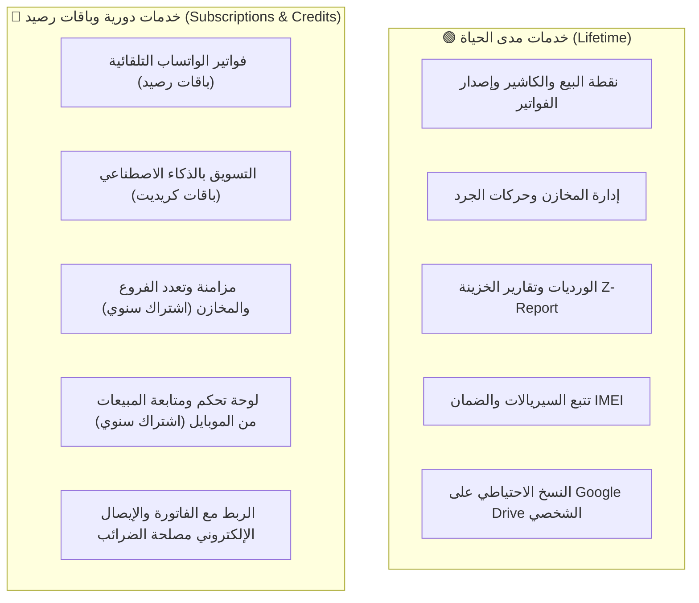

# 💎 قائمة الأسعار ودراسة الجدوى والتسعير — QuazLink POS & ERP
### وثيقة استراتيجية التسعير وهندسة الباقات للسوق المصري لعام 2026
**إعداد:** مجلس خبراء QuazCode CoWork (الإدارة العامة • هندسة النظم • خبير التسعير ودراسة السوق)  
**تاريخ التحديث:** أكتوبر 2026  
**الإصدار:** v1.3.7 Enterprise Ready

---

## 📌 1. القيمة العملية: ما الذي يقدمه النظام للعميل في شغله اليومي؟

نظام **QuazLink POS & ERP** تم تصميمه كـ **نظام تشغيل تجاري متكامل (Commercial Operating System)** يُلبي الاحتياجات الميدانية اليومية لأصحاب الأنشطة التجارية والمحلات، وليس مجرد آلة حاسبة لفواتير الكاشير:

| الميزة الميدانية | الفائدة المباشرة للتاجر وصاحب المحل |
|---|---|
| **كاشير سريع فوري (Lightning POS)** | سرعة إصدار فواتير بيع، شراء، ومرتجع بالباركود أو اللمس في ثوانٍ معدودة لمنع طوابير الزبائن. |
| **طباعة نقية لكافة الطابعات (Raster Print Engine)** | حل مشكلة الخط العربي الرديء في الطابعات الصينية الحرارية (80mm و 57mm) وطباعة فواتير A4/A5 الشاملة للشركات. |
| **حوكمة الورديات والخزينة (Shifts & Z-Report)** | تسليم وتسلم كاش إجباري، وجرد دقيق لمحتوى الدرج، وإصدار تقرير Z-Report ختامي يمنع عجز الخزينة وسرقة الكاشير. |
| **تتبع السيريالات والضمان (IMEI / Serial Tracking)** | ميزة حاسمة لمحلات الموبايل والكمبيوتر والأجهزة: تتبع كل قطعة بسيريالها وتاريخ بيعها وحالة ضمانها لمنع النصب والتلاعب. |
| **إدارة المخازن والجرد وتنبيهات النواقص** | جرد لحظي يوضح كمية وسعر تكلفة وسعر بيع كل صنف، وتنبيهات فورية قبل نفاد البضاعة لحماية التاجر من ضياع المبيعات. |
| **حسابات العملاء والموردين والآجل (CRM & Ledger)** | كشوفات حساب دقيقة لحركات الديون والمدفوعات والمتبقي على العملاء والموردين بنقرة واحدة. |
| **النسخ الاحتياطي السحابي لـ Google Drive** | حماية بيانات المحل من احتراق الهارد ديسك أو سرقة الجهاز؛ حيث تُرفع نسخة مشفرة تلقائياً إلى حساب Google Drive الخاص بالعميل. |
| **الفواتير الرقمية عبر واتساب (WhatsApp Receipts)** | توفير تكلفة رول الورق الحراري المرتفعة، مع إبهار الزبون بفاتورة رقمية أنيقة تصل لهاتفه مباشرة. |
| **محرك التسويق بالذكاء الاصطناعي (AI Marketing)** | صياغة عروض ترويجية وبوستات تسويقية واحترافية لمنتجات المحل تلقائياً لزيادة المبيعات على السوشيال ميديا. |
| **العمل أوفلاين بنسبة 100% (Offline-First)** | المحل يستمر في البيع والطباعة بكفاءة كاملة حتى في حال انقطاع الإنترنت، دون أي تعطيل لحركة التجارة. |

---

## ⚖️ 2. هندسة التراخيص: ما الذي يُباع "مدى الحياة" وما الذي يجب أن يكون "اشتراكاً دورياً"؟

> [!IMPORTANT]
> **القاعدة الحاكمة لحماية اقتصاديات الشركة:**
> * أي ميزة تعتمد على عتاد العميل وتعمل محلياً دون استهلاك خوادم الشركة -> **تُمنح مدى الحياة (Lifetime License)** لكسر مقاومة الشراء وجذب العميل المصري.
> * أي ميزة تستهلك سيرفرات الشركة السحابية، أو بوابات واتساب، أو اشتراكات ذكاء اصطناعي -> **تُباع كاشتراك سنوي دوري أو بنظام باقات الرصيد مسبقة الدفع (Prepaid Credits)** لضمان استمرار الربحية وتدفق دخل متكرر (MRR).

---

## 📊 3. دراسة السوق المصري للمنافسين (Market Intelligence 2026)

بناءً على مسح السوق الميداني لأبرز البرامج المنافسة في مصر:

| البرنامج المنافس | نوع الترخيص | متوسط الأسعار في السوق المصري | الملاحظات ونقاط الضعف التي نتفوق عليها |
|---|:---:|---|---|
| **دفترة (Daftra)** | سحابي (Cloud SaaS) | 1,000 إلى 2,500 ج / شهرياً (12,000 إلى 30,000 ج سنوياً) | تكلفة باهظة جداً ومتكررة على المحلات الفردية؛ يتعطل فور انقطاع الإنترنت. |
| **ديكسيف (DEXEF)** | رخصة دائمة / سنوية | تبدأ من 2,500 ج للنسخ البسيطة، وتصل إلى 9,000 - 18,000 ج للنسخ الاحترافية | واجهات كلاسيكية معقدة تتطلب تدريباً ومحاسباً متخصصاً، وصعوبة تشغيلها على الأجهزة القديمة. |
| **البدر للمبيعات** | سحابي أو شراء دائم | السحابي: ~37$ شهرياً (~1,850 ج) الدائم: ~500$ (~25,000 ج) | أسعار الشراء الدائم مرتفعة جداً وتعتمد على الدولار، مع رسوم إضافية لكل فرع أو ميزة. |
| **برامج الكاشير المحلية العادية** | شراء لمرة واحدة | 3,000 إلى 6,000 ج | برامج ديسكتوب قديمة (Visual Basic/Access) بدون حماية سحابية، ولا تدعم واتساب ولا ذكاء اصطناعي، وتتشوه خطوطها العربية. |

---

## 🏷️ 4. قائمة الباقات والأسعار الرسمية المقترحة (The Official Price List)

### 1️⃣ الباقة الأساسية: كاشير المحلات الفردية (Starter Lifetime)
* **السعر الرسمي:** **3,499 جنيه مصري** (تدفع لمرة واحدة فقط مدى الحياة).
* **الفئة المستهدفة:** البقالة، الأكشاك، المغاسل، محلات العطارة، والأنشطة الصغيرة ذات الكاونتر الواحد.
* **المواصفات:**
  * ترخيص دائم لجهاز واحد (Physical Motherboard HWID Locked).
  * كاشير سريع لإصدار فواتير البيع والشراء والطباعة الحرارية (80mm / 57mm) و A4/A5.
  * إدارة مخزن واحد وجرد الأصناف وتنبيهات النواقص.
  * إدارة الورديات وتقارير الخزينة (Z-Report).
  * ميزة النسخ الاحتياطي التلقائي إلى Google Drive مجاناً مدى الحياة.
  * تحديثات النظام الأساسية وتوافق كامل مع Windows 7 و Windows 10 و Windows 11.

---

### 2️⃣ الباقة الاحترافية: المحلات المتطورة (Business Pro Lifetime) ⭐ *(الأكثر مبيعاً)*
* **السعر الرسمي:** **5,999 جنيه مصري** (تدفع لمرة واحدة فقط مدى الحياة).
* **عرض الإطلاق الترويجي (لفترة محدودة):** **4,499 جنيه مصري**.
* **الفئة المستهدفة:** محلات الموبايل، الكمبيوتر، الملابس، السوبرماركت الكبير، الأدوات المنزلية، ومعارض الأجهزة.
* **المواصفات:**
  * **جميع ميزات الباقة الأساسية بالكامل**.
  * **نظام حوكمة السيريالات وتتبع الضمان (IMEI & Serial Number Tracking)** لحماية المحل من النصب.
  * **دفتر حسابات العملاء والموردين وإدارة الديون والأرصدة الآجلة (CRM & Ledger)**.
  * هيكل الفاتورة والإيصال الإلكتروني المعتمد لمصلحة الضرائب المصرية (ETA QR Code & UUID).
  * **باقة هدايا مجانية ترحيبية:**
    * 🎁 رصيد 200 رسالة فاتورة واتساب للعملاء.
    * 🎁 رصيد 50 كريديت تسويق ذكي بالذكاء الاصطناعي (AI Marketing).

---

### 3️⃣ باقة المؤسسات والسلاسل السحابية (Enterprise Cloud)
* **السعر السنوي:** **4,800 جنيه مصري / سنوياً** (تعادل **400 جنيه شهرياً فقط**).
* **الفئة المستهدفة:** الشركات التي تمتلك فروعاً ومخازن متعددة، أو التجار الذين يرغبون في متابعة المبيعات من هواتفهم في أي مكان.
* **المواصفات:**
  * ربط سحابي حي فوري بين كافة الفروع والمخازن المركزية.
  * لوحة تحكم سحابية وتقارير مبيعات وأرباح مباشرة على هاتف المالك من أي مكان في العالم.
  * تقارير يومية تلقائية تُرسل إلى واتساب المالك عند إغلاق كل وردية.
  * دعم فني VIP بأولوية قصوى ودعم النسخ الاحتياطي المركزي المشفر.

---

## 🔋 5. باقات شحن الخدمات الإضافية مسبقة الدفع (Prepaid Add-ons)
*(مصدر دخل إضافي متكرر ومستمر للشركة)*

### أ) باقات رسائل فواتير الواتساب (WhatsApp Direct Receipts):
* **باقة 500 رسالة:** **150 جنيه مصري** (تكلفة الرسالة 30 قرش فقط).
* **باقة 1,500 رسالة:** **350 جنيه مصري** (تكلفة الرسالة ~23 قرش).
* **باقة 5,000 رسالة (للمحلات ذات الكثافة العالية):** **999 جنيه مصري**.

### ب) باقات التسويق بالذكاء الاصطناعي (AI Copywriting & Marketing):
* **باقة 100 منشور إعلاني ذكي:** **199 جنيه مصري**.
* **باقة 300 منشور إعلاني ذكي:** **450 جنيه مصري**.

---

## 🖥️ 6. عروض تجميعات الأجهزة الكاملة (Hardware Bundles - الاختيارية)
عند رغبة العميل في شراء أجهزة الكاشير مع البرنامج في باقة واحدة متكاملة:

| العرض المتكامل | العتاد المشمول | سعر الباقة مع البرنامج (Starter) |
|---|---|:---:|
| **عرض الكاشير الاقتصادي** | طابعة فواتير حرارية 57mm + قارئ باركود ليزري اقتصادي + البرنامج | **5,999 جنيه** |
| **عرض الكاشير القياسي** | طابعة فواتير حرارية 80mm أوتوماتيك + قارئ باركود سريع + درج نقدية 5 خانات + البرنامج | **8,999 جنيه** |
| **محطة الكاشير الشاملة (POS Terminal)** | شاشة لمس احترافية (Touch Terminal) + طابعة 80mm + درج + باركود + البرنامج (Pro) | **17,500 - 22,000 جنيه** |

---

## 🎯 7. دليل إغلاق الصفقات لمندوبي المبيعات (Sales Closing Pitch)

عند التحدث مع أي تاجر متردد في الشراء، استخدم الحجج البيعية التالية:

1. **مقارنة التكلفة ضد البرامج السحابية:**
   > *"برامج الكاشير السحابية بتطلب منك 1,500 جنيه كل شهر يعني هتدفع 18 ألف جنيه في السنة وكل سنة هتفضل تدفع! مع QuazLink هتدفع 3,499 أو 4,499 جنيه مرة واحدة في حياتك والبرنامج ملكك بالكامل بدون ما تجدد كل شهر."*
2. **الضمان والأمان المالي ضد السرقات:**
   > *"بتقرير وردية واحد مقفول (Z-Report)، وسيستم تتبع سيريالات الأجهزة، البرنامج هيحميك من عجز درج واحد أو سرقة جهاز ممكن تكلفك آلاف الجنيهات في شهر واحد."*
3. **أمان البيانات السحابي بدون اشتراك:**
   > *"مش هتقلق من احتراق الهارد ديسك أو ضياع الفواتير؛ البرنامج بيرفع نسخة احتياطية آمنة على حسابك في Google Drive بنقرة واحدة ومجاناً مدى الحياة."*
4. **التجربة العملية المجانية:**
   > *"عندك 30 يوم تجربة مجانية كاملة على جهازك بدون ما تدفع مليم؛ جرب وشوف شغلك ماشي إزاي قبل ما تقرر الشراء."*

---

## 📞 8. قنوات المبيعات والتفعيل والدعم الفني

* **خط المبيعات والتفعيل المباشر (واتساب / هاتف):** `01019078440`
* **رابط الواتساب الفوري:** [تواصل مع المبيعات عبر واتساب](https://wa.me/201019078440)
* **الموقع والمنصة الرسمية:** `https://app.quazlink.site`
* **طرق الدفع المتاحة:** فودافون كاش، إنستاباي (InstaPay)، تحويل بنكي، ودفع نقدي مع المندوب.
